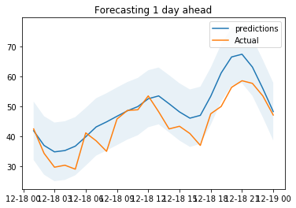

<!-- readme-visual-refresh:banner -->

<!-- /readme-visual-refresh:banner -->

# Multivariate Singular Spectrum Analysis (mSSA)

Multivariate Singular Spectrum (mSSA) is an algorithm for multivariate time series forecasting and imputation. 
Specifically, mSSA allows you to predict entries that are:

1. At a future time step (i.e. forecasting);

2. Missing/corrupted by noise (i.e. imputation)


This repository is the implementation of the [paper: On Multivariate Singular Spectrum Analysis](https://arxiv.org/abs/2006.13448). Refer to the paper for  more information about the theory and the algorithm of mSSA.  


## Installation
This work has the following dependencies:

- Python 3.5+ with the libraries: (numpy, pandas, scipy, sklearn)
 

To install the mSSA package form the source, simply clone this repository and then install the package using pip as follows:

```
pip3 install .
``` 

## Getting Started
To get started, first load the time series example we have provided in `../mSSA/examples/testdata/tables/mixturets_var.csv` using pandas.

```python
import pandas as pd
df = pd.read_csv("mssa/examples/testdata/tables/mixturets_var.csv")
```
Then initialise and fit your  mSSA model on the time series named `ts` as follows:
 
```python
from mssa.mssa import mSSA
model = mSSA()
model.update_model(df.loc[:,['ts']]) 
```
Then you can impute or forecast any entry using the predict function. For example:

```python
prediction = model.predict('ts',1000)
```

will impute the 1000th entry, while 
```python
prediction = model.predict('ts', 100001,100100)
```

will forecast the entries between 100001 to 100100.


## API
Refer to the documentation of the mSSA class in [here](API.md). 

## Example
We provide a running example for both synthetic and real-world datasets in a python notebook in the mssa/examples folder. [Here](/mssa/examples/mSSA_notebook_example.ipynb).
## License 
This work is licensed under the Apache 2.0 License.

<!-- readme-visual-refresh:artwork-source -->
[Editable banner artwork · Excalidraw](assets/readme/banner.excalidraw)
<!-- /readme-visual-refresh:artwork-source -->


<!-- readme-visual-refresh:selected-result -->

## 已有结果展示



原示例 Notebook 保存的一天超前预测：预测均值、区间与实际时间序列对照。 该图为仓库已有上游示例，保留原有来源；本次仅整理展示，未重新运行。 [查看来源](https://github.com/GISWLH/mSSA/blob/master/mssa/examples/mSSA_notebook_example.ipynb)。

<!-- /readme-visual-refresh:selected-result -->
